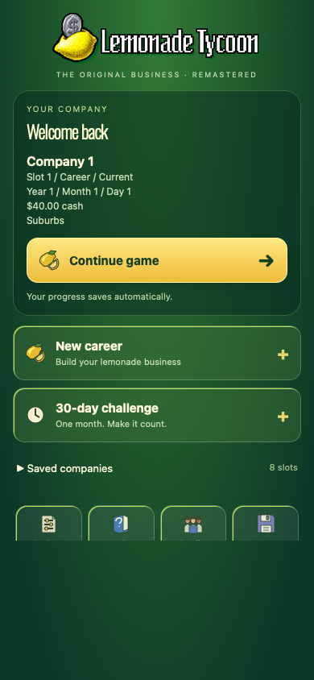
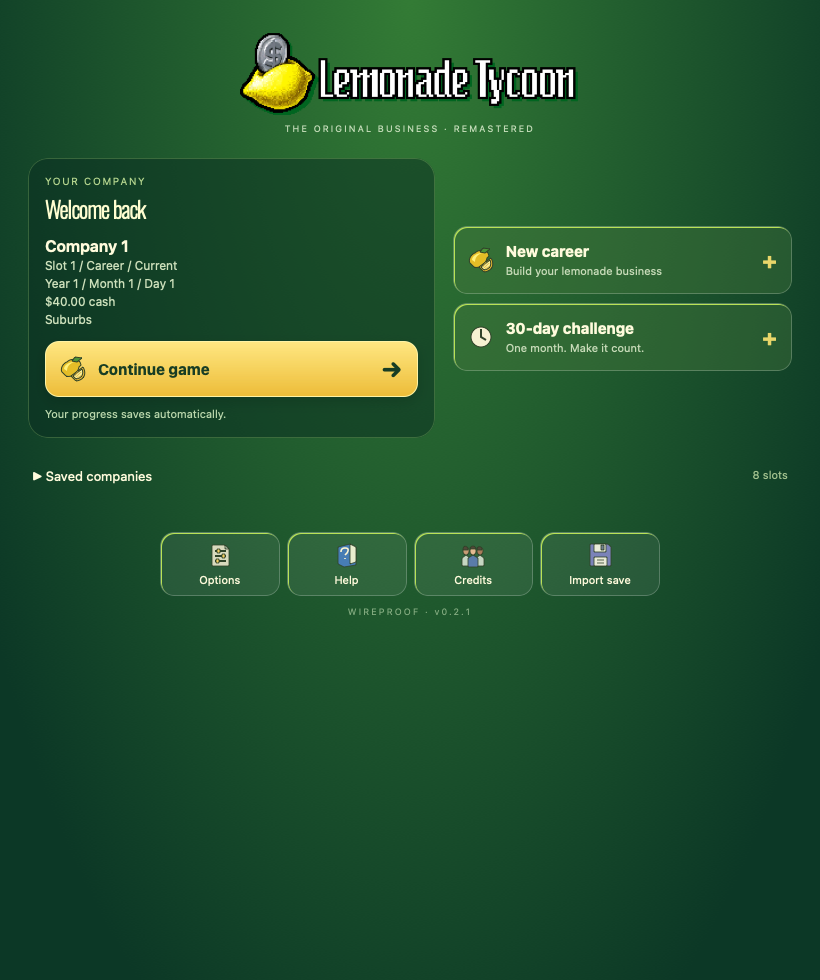

# Lemonade Tycoon Remastered — iPhone / Duo

Version 0.2.1, playable development build. An unofficial reconstruction of the first Lemonade Tycoon, guided by the user's original Palm game and community research into the first PC game. This is not recovered original source and is not an official Hexacto release.

## Included

Offline career and 30-day challenge, recipe and price controls, supplies, animated selling and queues, forecasts and news, equipment and staff, daily/cumulative reports, eight company slots, autosave and save import/export. The playable location selection is the original Palm roster: Suburbs, Park, Beach, Downtown and Mall.

Cover presentation keeps management tabs at the bottom, with a scrollable play area and expandable Menu / Settings. Inner presentation places management and the complete street scene side by side. Layout follows available width and safe areas, with a brief settling delay and an explicit Auto / Cover / Inner override. The same running game and save continue across layout changes. There is no verified private fold-state API or hardware-specific geometry claim.

The native UIKit/WKWebView shell serves all resources through an in-process local URL handler; no website, server, login or Internet connection is required. Rendering uses a capped 20 fps canvas. Export uses the native share sheet and writes a JSON backup to the app's Documents directory.

## Delivery

`LemonadeTycoon-Remastered-v0.2.1.ipa`, bundle `com.wireproof.lemonadetycoon`, build 4, iOS 16 minimum. Standalone Apple Development signing and provisioning for the paired Duo. Updates preserve the standalone app container. Existing LiveContainer data is untouched and is not automatically migrated.

## Build

Node and npm: in `game`, run `npm ci --ignore-scripts`, `npm run typecheck`, `npm test`, `npm run build-nolog`.

Then at repository root: `python3 ios/build.py device` (or `simulator`). Requires Xcode's iOS SDK. `npx playwright test --config playwright.duo.config.cjs` in `game` runs the WebKit Duo regression tests. Simulator-only `--smoke-test` launches an actual offline trading day and writes `Documents/native-smoke.json`; this hook is compiled out of device builds.

## Verification

98 simulation/save tests passed. WebKit tests exercise cover and inner trading, resizing, reload recovery, challenge creation and compact menu accessibility. Physical Wi-Fi installation and launch are checked separately; full on-device gameplay and fold transitions remain pending.

## Fidelity status

The original PRC help and resource inventory are documented in `research/original-findings.md`. This build adapts Gamez0 / Willow Lane Lemonade's MIT-licensed simulation, with five original PC scenery backgrounds and the original logo extracted from the supplied media. The menu is rebuilt responsively and the app icon is newly generated. Original resources are private reference assets; see ORIGINAL-ASSETS-NOTICE.txt. Upstream commit: fee1153e4733d5a95a19e0b7c643b15b523ae9fe.

Known differences requiring further original-game work:

- The five location rents and recipe taste formula are recovered from original evidence. Other prices, unlock rules, traffic and equipment effects still include reconstruction tuning.
- The Palm original ages lemons and sugar and uses its refrigerator to preserve lemons. This base currently carries those ingredients indefinitely and uses refrigeration to retain ice. Full batch-age inventory is not implemented.
- The Palm original's six equipment items, four save slots and exact staff choices are not replicated exactly. This build retains the community equipment/staff system and eight slots.
- Original scenery and logo are integrated; character animations and foreground layers still use the community recreation. The responsive menu is a new implementation.
- Extra first-PC-version location definitions remain for upstream save compatibility, but only the five Palm locations are selectable. Some inherited news references mention other first-PC-version venues.
- Device cover/inner transitions, touch comfort and performance still require physical Duo acceptance. Simulator and browser evidence cannot establish those.

This is a playable foundation for the requested remaster, not a claim of complete original-game parity.

## Credits

Original Lemonade Tycoon: Hexacto. Reconstruction base: https://github.com/Gamez0/lemonade-tycoon (MIT; retained in `game/LICENSE`). WIREPROOF iPhone adaptation. Phaser: MIT. Oswald font: SIL Open Font License (bundled notice). Original PRC is retained only in the user's existing library, not shipped in this app. Research-only extracted text is excluded from source release ZIPs.

## Screenshots

These captures are from development verification; appearance may differ on other devices.

| Duo cover | Duo inner |
| --- | --- |
|  |  |

The release IPA is unsigned and requires your own Apple signing and provisioning. This repository is private because it includes original game resources.
