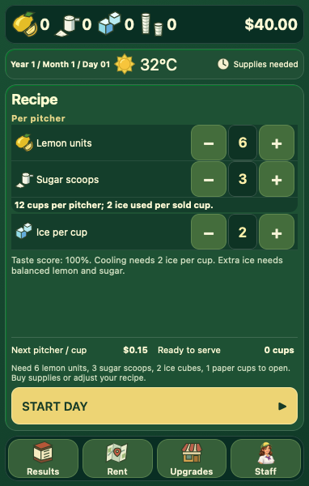
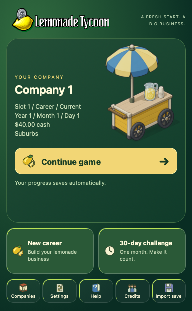
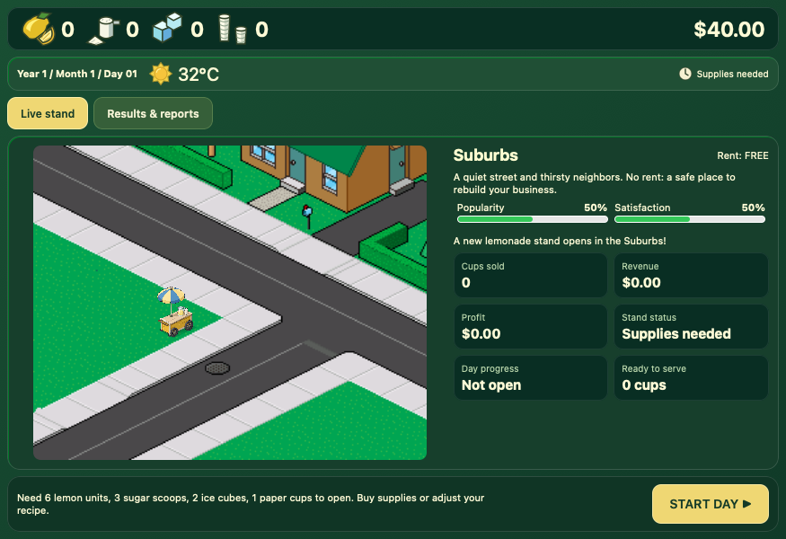
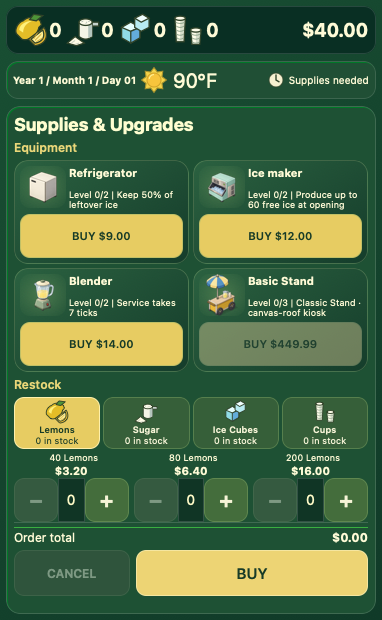
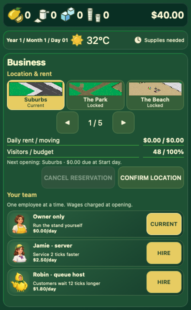
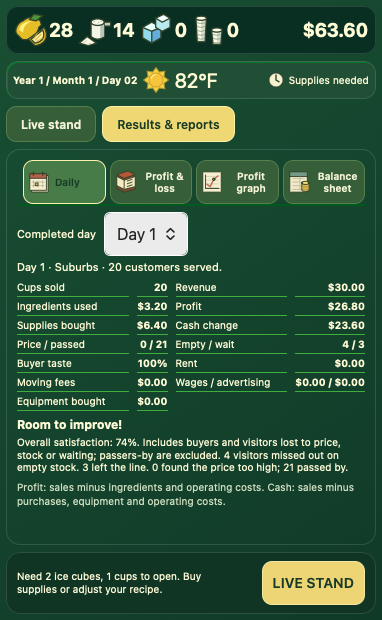

# Lemonade Tycoon Remastered — iPhone and iPad

Version 0.3.0, playable development build. An unofficial reconstruction of the first Lemonade Tycoon, guided by the user's original Palm game and community research into the first PC game. This is not recovered original source and is not an official Hexacto release.

Five native destinations replace the separate management pages and bottom toolbar: Menu; Stand and reports; Business (locations and staff); Shop (supplies and equipment); and Recipe & Marketing. Management pages use the full workspace. Stand has a large scene, live statistics, integrated reports and a dedicated action footer. The welcome menu is rebuilt with a company card, career/challenge choices and a separate company library. The approved app icon and save format are preserved.

## Included

Offline career and 30-day challenge, recipe and price controls, supplies, animated selling and queues, forecasts and news, equipment and staff, daily/cumulative reports, eight company slots, autosave and save import/export. The playable location selection is the original Palm roster: Suburbs, Park, Beach, Downtown and Mall.

Native navigation adapts to the system: the Duo uses its sidebar and iPad uses system tabs. There is no second bottom toolbar. The combined management screens fit the tested cover and inner viewports without content paging. Layout follows usable width and safe areas, with an Auto / Cover / Inner override in Settings. The same running game and save continue across layout changes. There is no verified private fold-state API or hardware-specific geometry claim.

The native UIKit/WKWebView shell serves all resources through an in-process local URL handler; no website, server, login or Internet connection is required. Rendering uses a capped 20 fps canvas. Export uses the native share sheet and writes a JSON backup to the app's Documents directory.

## Delivery

The v0.3.0 prerelease includes `com.wireproof.lemonadetycoon-0.3.0-13-unsigned.ipa` for iPhone and iPad (iOS 16 or later). It requires your own signing before installation. Bundle ID: `com.wireproof.lemonadetycoon`; Home Screen name: Lemonade. The source includes all game graphics, audio, fonts and native icon assets.

## Build

Node and npm: in `game`, run `npm ci --ignore-scripts`, `npm run typecheck`, `npm test`, `npm run build-nolog`.

Then at repository root: `python3 ios/build.py device` (or `simulator`). Requires Xcode's iOS SDK. `npx playwright test --config playwright.consolidated.config.cjs` in `game` runs the WebKit Duo regression tests. Simulator-only `--smoke-test` launches an actual offline trading day and writes `Documents/native-smoke.json`; this hook is compiled out of device builds.

## Verification

Build 13 verification and device delivery are recorded in `verification/v0.3.0`. Browser layout checks cover four usable viewport sizes and exercise the five destinations. A separate trading flow checks purchasing, day-end reports, native navigation actions and save retention. The Duo native simulator passed an offline trading day, artwork readiness, five-tab navigation and save retention. The iPad native simulator installation timed out, so its fresh native runtime check remains incomplete. Duo build 13 installation and 13 unchanged save files are verified; physical iPad delivery is pending availability. Neither physical app was launched. Physical installation, runtime testing and visual acceptance are recorded separately; simulator and browser checks do not establish physical fold-transition behavior.

## Fidelity status

This build adapts Gamez0 / Willow Lane Lemonade's MIT-licensed simulation, with five original PC scenery backgrounds and the original logo extracted from the supplied media. The menu is rebuilt responsively and the app icon is newly generated.  Upstream commit: fee1153e4733d5a95a19e0b7c643b15b523ae9fe.

Known differences requiring further original-game work:

- The five location rents and recipe taste formula are recovered from original evidence. Other prices, unlock rules, traffic and equipment effects still include reconstruction tuning.
- The Palm original ages lemons and sugar and uses its refrigerator to preserve lemons. This base currently carries those ingredients indefinitely and uses refrigeration to retain ice. Full batch-age inventory is not implemented.
- The Palm original's six equipment items, four save slots and exact staff choices are not replicated exactly. This build retains the community equipment/staff system and eight slots.
- Original scenery and logo are integrated; character animations and foreground layers still use the community recreation. The responsive menu is a new implementation.
- Extra first-PC-version location definitions remain for upstream save compatibility, but only the five Palm locations are selectable. Some inherited news references mention other first-PC-version venues.
- Device cover/inner transitions, touch comfort and performance still require physical Duo acceptance. Simulator and browser evidence cannot establish those.

This is a playable foundation for the requested remaster, not a claim of complete original-game parity.

## Credits

Original Lemonade Tycoon: Hexacto. Reconstruction base: https://github.com/Gamez0/lemonade-tycoon (MIT; retained in `game/LICENSE`). WIREPROOF iPhone adaptation. Phaser: MIT. Oswald font: SIL Open Font License (bundled notice).

## Screenshots

These captures are from development verification; appearance may differ on other devices.

These are WebKit layout verification captures, not physical-device screenshots.

| Complete cover recipe | Complete cover welcome |
| --- | --- |
|  |  |

| Combined Shop | Business | Daily report |
| --- | --- | --- |
|  |  |  |

The release IPA is unsigned and requires your own Apple signing and provisioning.
